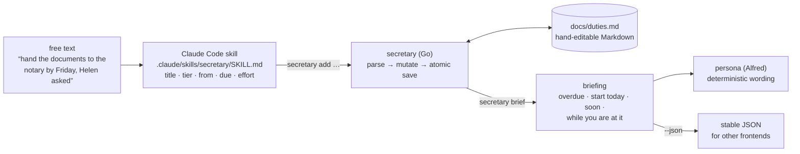

# secretary

[](https://github.com/bayanovea/secretary/actions/workflows/ci.yml)

A command-line secretary for one person's duties. You describe an obligation in plain words,
a Claude Code skill turns it into structured fields, and a Go binary keeps everything in one
Markdown file you can read and edit by hand. Every morning the binary tells you, in the voice of
a dry English butler, what has to be *started* today — not what is already late. I built it
because my own list of errands kept failing in three ways: things were written down too late,
noticed too late to start, and done in three trips when one would do.

## How it works



The split is strict. The skill is the only fuzzy component: it reads a sentence and chooses
flags. The binary never guesses: it computes the latest start date (`due − effort − tier buffer`),
sorts, groups duties that share a place or a person, and phrases the result.

## Try it in two minutes

You need Go 1.19 or newer. The repository ships with a small synthetic artifact, dated
14 October 2026, so the hidden `--today` flag replays that day and the output below is exactly
what you will see.

```sh
git clone https://github.com/bayanovea/secretary && cd secretary
go build -o secretary ./cmd/secretary
./secretary --today=2026-10-14 brief
```

```
Good morning, sir. It is 14 October; allow me to set out the state of affairs.

Overdue:
  · «Send the invoices to Northwind»: 4 days past due, sir. It only gets more awkward from here.

Start today:
  · Sir, it is time to begin «Collect the documents from the notary». Today, that is, not «this week».

Soon:
  · «Prepare the Q3 report» comes due for a start in 1 day, sir. Not urgent, but do not forget it either.

While you are at it:
  Since you will be at @computer anyway, sir, you might as well:
    — T-001 «Prepare the Q3 report» · tier 1 · due 2026-10-20
    — T-005 «Sort out the home insurance» · tier 1
    — T-008 «File the quarterly tax return» · tier 1 · due 2026-11-15
  Since you will be at @town anyway, sir, you might as well:
    — T-002 «Collect the documents from the notary» · tier 1 · due 2026-10-17
    — T-003 «Buy Helen a birthday present» · tier 2 · due 2026-10-24
    — T-006 «Pick up the parcel from the post office» · tier 3
  …

Separately:
  · «Send the invoices to Northwind» has been deferred 2 times already, sir. At some point that stops being a schedule and becomes a decision.

Open: Critical — 4 · Important — 3 · Background — 3.
At your service, sir.
```

Then add a duty, mark one done, and look at the file:

```sh
./secretary --today=2026-10-14 add --title "Renew the passport" --tier 1 --from self \
    --due 2026-11-20 --effort 2h --section Personal --context @town --labels documents
./secretary --today=2026-10-14 done T-004
./secretary --today=2026-10-14 list
cat docs/duties.md
```

`list` prints aligned columns with a status glyph, `!!`/`!` tier marks, the deadline as a person
would say it (`yesterday`, `Sat 17 Oct`) and the checklist under each duty. The same information
is in `docs/duties.md`, which `cat` shows is ordinary Markdown with a `tier:… · from:… · due:…`
line under each item. `go test ./...` runs the whole suite in a few seconds.

To use it for real, keep your data outside the checkout: `export SECRETARY_HOME=$HOME/.secretary`
with your own `secretary.yml` and artifact there. The skill works from any Claude Code session
opened in the repository.

## Design decisions

**The latest start date is the product, not the deadline.** Every other list warns you when a
deadline has passed. This one computes `due − effort − buffer(tier)` and nags from that day on, so
a report that takes three days is raised three days plus a margin before Friday. Cost: the user has
to estimate effort, and a tier-1 duty without one makes Alfred complain in every briefing until it
is fixed. That complaint is deliberate.

**One Markdown file is the whole state.** No database, no server, no daemon. The file is
hand-editable, diffable, and survives the program being deleted. The parser is forgiving about
spacing and unknown lines, strict about tiers, dates and efforts, and drops everything the renderer
generates (status hints, the `Updated:` line), so `parse(render(parse(x))) == parse(x)` is a
fixed point asserted by a round-trip test. Cost: no concurrent writers beyond atomic
temp-file-and-rename, and no history beyond git.

**The AI layer is a Claude Code skill, and it is the only fuzzy component.** `SKILL.md` holds the
persona, the tier heuristics, the ask-versus-assume rule and relative-date resolution, and turns a
sentence into `secretary add` flags. It never computes a date and never touches the file. The
binary accepts absolute dates only, so a misread "Friday" is visible in the reply rather than
buried in arithmetic. Tests check that the skill still documents every subcommand and every
`add` flag, so the prompt cannot drift from the CLI it drives. Cost: the free-text intake needs
Claude Code; without it the tool is a plain CLI.

**No package reads the clock.** `time.Now()` appears once, in `main.go`, truncated to a UTC day;
everything else takes `now` as a parameter. Same file plus same day gives byte-identical output,
which is what makes golden-file tests meaningful and lets a scheduler tell "nothing changed" from
"something new is on fire". Cost: a hidden `--today` flag that must exist and must stay out of the
usage text.

**The persona is data, and its wording is deterministic.** `voice.Persona` is an interface;
Alfred is one file. A phrase variant is chosen by an FNV hash of the facts it describes (duty id,
day), never by `math/rand`, so Alfred says the same thing twice on the same day and something
different tomorrow. `brief` decides *what* is said and in which order; `voice` decides *how*. No
sentence about a duty lives in `brief`, no scheduling decision lives in `voice`. Cost: a second
language or a second butler is a new file, but a new *kind* of remark changes the interface.

**Tests are the gate, not the documentation.** Logic packages sit above 80% coverage with table
tests; the two format-shaped outputs (the artifact, the briefing) have golden files regenerated
with `-update` and reviewed as a diff; the CLI has an acceptance suite that drives the built
binary through the README's own claims, including the hand-editing guarantee. Exit codes separate
"you called it wrong" (2) from "it refused on the merits" (1) so a script can tell the two apart.

## Status and limits

Phase 1 works and I use it daily: the CLI, the skill, the artifact, recurring duties through
`launchd` (see [docs/RECURRING.md](docs/RECURRING.md)). Alfred's register is deliberately
old-fashioned, and that is a taste, not a bug.

What is rough: the effort model is one number, so a duty blocked on someone else's response is
either over-estimated or left without an effort; grouping is greedy, one duty joins the first batch
that claims it; the persona interface has grown method by method and would be cleaner as a small
set of event types. The Telegram bot is designed in [docs/PHASE2.md](docs/PHASE2.md) and
implemented on a private branch, but is not part of this repository yet.

What I would do differently: start with `brief --json` as the contract and treat the text as one
renderer of it, rather than arriving there after the fact; and make the artifact's field keys a
versioned schema from day one, since changing them is a format change that touches five places.

<details>
<summary>Commands and flags</summary>

| Command | What it does |
|---|---|
| `secretary add --title "…" --tier N --from "…" [--due YYYY-MM-DD] [--effort Nh\|Nd\|Nw] [--section "…"] [--labels "a, b"] [--context @place] [--note "…"] [--step "…"]` | record a duty; prints the assigned identifier |
| `secretary brief [--json]` | the briefing: overdue, start today, soon, groups, complaints |
| `secretary list [--tier N] [--section S] [--label L] [--context @C] [--sort date\|tier] [--color auto\|always\|never]` | open duties in aligned columns, by deadline by default |
| `secretary step <id> [--add "…"] [--check N] [--uncheck N] [--drop N]` | checkbox steps inside a duty; no flags shows them numbered |
| `secretary step <id> --set N [--tier 1..3\|-] [--due YYYY-MM-DD\|-]` | a step's own tier and deadline; `-` clears the field |
| `secretary done <id>` | move into `## Done` with a `done:` date |
| `secretary defer <id> --due YYYY-MM-DD` | move the deadline; `deferrals:` is counted automatically |
| `secretary fmt` | re-read, recompute hints, re-sort, rewrite the artifact |
| `secretary check` | verify the artifact parses and name duties with incomplete data |
| `secretary archive` | move duties completed more than 30 days ago into the archive file |

Global flags: `--config PATH`, `--artifact PATH`, before or after the command name. `--note` and
`--step` may be repeated. Exit codes: `0` done, `1` refused on the merits, `2` called wrong.

Environment: `SECRETARY_HOME` is the directory holding a private `secretary.yml` and artifact;
relative paths in that configuration resolve against it. `NO_COLOR` disables colour in `list`.
There are no secrets.

</details>

<details>
<summary>The artifact format</summary>

```markdown
# Duties

<!-- secretary:v1 -->
> Updated: 2026-10-14 · At your service, sir.

## Personal

- [ ] `T-002` **Collect the documents from the notary**
  tier:1 · from:Helen · due:2026-10-17 · effort:2h · context:@town · created:2026-10-09
  labels: paperwork, documents
  > notary is open until 18:00, mornings are crowded
  - [x] call and book a slot · tier:1 · due:2026-10-13
  - [ ] go and collect
  🔴 start by 2026-10-14

## Done

- [x] `T-000` **Pay the internet bill** · done:2026-10-03
```

| Key | Required | Format | Note |
|---|---|---|---|
| `tier` | yes | `1` \| `2` \| `3` | 1 critical (consequences for others), 2 important, 3 background |
| `from` | yes | text | `self` when nobody else asked |
| `due` | no | `YYYY-MM-DD` | without it the status is "no deadline" |
| `effort` | no | `Nh` \| `Nd` \| `Nw` | working hours, days or weeks; needed for the start date |
| `context` | no | `@word` | the main grouping key |
| `deferrals` | no | number | grows on `defer` |
| `created` | auto | `YYYY-MM-DD` | written by `add`; "stale" is measured from it |

`labels:` is a separate comma-separated line. Lines starting with `>` are free notes. `- [ ]`
lines inside a block are steps of the same duty; a step may carry its own `tier:` and `due:` at
the end of its line, nothing else. Lines starting with 🔴 ⏰ 🟡 💤 are computed hints: they are
dropped on read and rewritten on every save, so editing them is pointless.

Sections, contexts, tiers and windows come from `secretary.yml`; every key has a default, so the
file may be absent. A section that is not configured is not an error: the artifact keeps it and
`check` mentions it.

| Key | Meaning |
|---|---|
| `persona` | whose voice the briefing uses; only `alfred` exists |
| `artifact` | path to the artifact, default `docs/duties.md` |
| `archive` | where `archive` moves duties completed more than 30 days ago |
| `sections` | sections and their order; the first is the default for `add` |
| `contexts` | known contexts (`@town`, `@phone`…) |
| `tiers` | name and buffer per tier: `buffer_min_days`, `buffer_ratio` |
| `soon_window_days` | how many days before the start date a duty becomes "soon" |
| `stale_days` | how long a duty may sit without a deadline before Alfred mentions it |

</details>

<details>
<summary>Editing by hand</summary>

- Change anything except the `` `T-00N` `` identifier: it is how `done` and `defer` find a duty.
  A duty added by hand may have no identifier at all; `fmt` assigns one.
- Steps are plain Markdown: add a `- [ ] …` line under a duty or turn `[ ]` into `[x]`. An empty
  checkbox with no text is a parse error.
- Run `secretary fmt` after editing. It keeps the heading, your notes and unconfigured sections
  verbatim. It deliberately drops two things: hint lines, which it recomputes, and field keys it
  does not know.
- `secretary check` reports whether the file parses without touching it. If `check` complains,
  fix the line it names before running `fmt`.

Writes are atomic: the file is written to a temporary name and renamed over the original, so an
interrupted command leaves the previous artifact intact.

</details>

<details>
<summary>More</summary>

- [docs/RECURRING.md](docs/RECURRING.md) — recurring duties live in cron or launchd, not in the tool.
- [docs/PHASE2.md](docs/PHASE2.md) — the `brief --json` seam and the two deferred frontends.
- [docs/plans/](docs/plans/) — the implementation plans the work was done from.
- [CLAUDE.md](CLAUDE.md) — the conventions the tests depend on.
- [LICENSE](LICENSE) — MIT.

</details>
